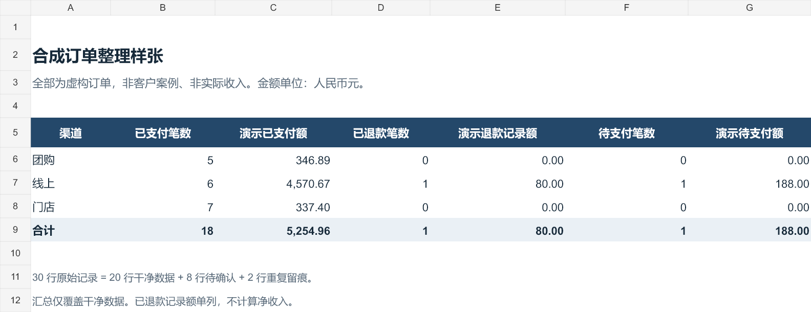

# 订单数据整理演示

**全部为合成数据，非客户案例，也不代表实际销售或收入。** 代码采用 AI 辅助编写，并做了下列本地核对。

这个样例展示如何把重复、冲突和无效订单分开处理，同时保留原始记录、处理依据和逐行来源。它包含固定结构的 CSV 清洗脚本，以及一份可查看的 Excel 报告快照。



## 运行

Python 3.10+，清洗脚本只用标准库：

```sh
python clean_orders.py
python verify_sample.py
```

也可处理同结构文件：

```sh
python clean_orders.py orders.csv --out result
```

源列名及顺序必须是 `order_id,order_date,channel,product,amount_cny,status`。这个样例不会自动猜测业务字段，不用于直接套用任意客户文件。输入需为 UTF-8 CSV。

## 规则和结果

- 明确规定一条订单对应一个订单号；一单多件的明细需要另定主键。
- 标准化后全字段相同才去重；同主键内容冲突时，相关记录全部进入异常表。
- 日期只接受明确声明的年份在前格式；金额使用 Decimal，零金额保留。
- 不猜填缺失数据，不把已退款订单额推断为实际退款额或净收入。
- 原始 30 行 = 整理结果 20 行 + 待确认 8 行 + 重复留痕 2 行。
- 已核对：逐行守恒、独立金额核对、零值、无效日期/金额、主键冲突、原文件不变、重复运行一致。

运行后，`output/` 会生成整理结果、异常、重复、逐行去向、分渠道汇总和审计 JSON。`sample-report.xlsx` 是合成示例的 Excel 报告快照，包含三个工作表；运行上面的 Python 命令更新 CSV/JSON，不会重新生成该 Excel 快照。

## 按实际规则定制

可根据买家确认的字段、主键、日期金额口径和验收标准，提供表格整理或可重复运行的脚本。基础整理 299 元、含脚本 599 元；先评估样例与范围，确认后再下单。具体服务范围以[闲鱼服务页](https://www.goofish.com/item?id=1096086362467)为准。

请勿在公开 issue 中上传个人信息、凭证或未获授权的数据；演示和询价使用脱敏样例。
